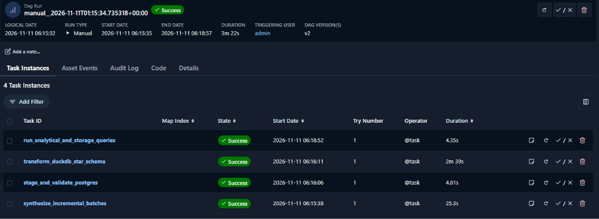

# Pharma Cold Chain Data Warehouse (Phase 1, Milestone 1)

Course project for Intelligent Data Architectures. Phase 1 builds the Sales and Demand Intelligence (SDI) mart from raw files to an analytical query layer, orchestrated by Apache Airflow.

## Architecture
generate (`oversample.py`) -> ingest + validate (`ingest_staging.py`, PostgreSQL) -> star schema (`build_datamart.py`, DuckDB) -> queries (`run_queries.py`), orchestrated by the Airflow DAG `phase1_sdi_pipeline`.

See `docs/star_schema_diagram.png` for the data model and `docs/` for the reports.

## Repository layout
- `dags/` Airflow DAG (`phase1_sdi_pipeline.py`)
- `scripts/` the four pipeline scripts (`oversample.py`, `ingest_staging.py`, `build_datamart.py`, `run_queries.py`)
- `sql/` staging schema DDL (`01_staging_schema.sql`)
- `docs/` diagram, logs, and milestone reports
- `docker-compose.yaml` Airflow (Worker, Scheduler, API Server), Redis, Postgres, and staging DB
- `data/` is NOT in the repo (large files). Put the three source CSVs in `data/raw/`.

## Setup (Windows, Docker Desktop with WSL 2)
1. Clone the repo, create `data/raw`, `data/landing`, `logs`, `config`, `plugins`.
2. Put `01_master_data.csv`, `05_pharmacy_sales_data.csv`, `06_hospital_demand_data.csv` into `data/raw/`.
3. Create `.env` with `AIRFLOW_UID=50000` and `FERNET_KEY=<your own key>`.
4. Ensure `AIRFLOW__API_AUTH__JWT_SECRET` is defined in `docker-compose.yaml` so Airflow services authenticate task tokens properly.
5. Give Docker at least 5 GB RAM (`%USERPROFILE%\.wslconfig`: `memory=5GB`) and keep 20 GB free disk.
6. `docker compose up airflow-init`, then `docker compose up -d`. Wait a few minutes (packages install at startup).
7. Airflow UI: http://localhost:8080. Staging database: `localhost:5433`, db `staging`, user `dwh`.
8. Create the staging tables by running `sql/01_staging_schema.sql`.

## Run the pipeline
Trigger `phase1_sdi_pipeline` directly in the Airflow UI (http://localhost:8080), or test CLI execution inside the container:
```powershell
docker compose exec airflow-worker airflow dags test phase1_sdi_pipeline
```
Or run the scripts manually in order from the project root:
`python scripts\oversample.py`, `python scripts\ingest_staging.py`, `python scripts\build_datamart.py`, `python scripts\run_queries.py`

## Status
- **Scripts, Staging & Star Schema:** Working with SCD Type 2 on `Dim_Medicine` and DuckDB analytical queries logging sub-second response times (~13–16 ms).
- **Orchestration:** Fully functional end-to-end. Both CLI test runs and manual triggers from the Airflow Web UI / Celery worker execute all four tasks sequentially to 100% green `Success` (Run Duration: ~3m 22s).
- **Upcoming Items:** File-watcher trigger integration and Phase 2 Inventory Mart.
- 
